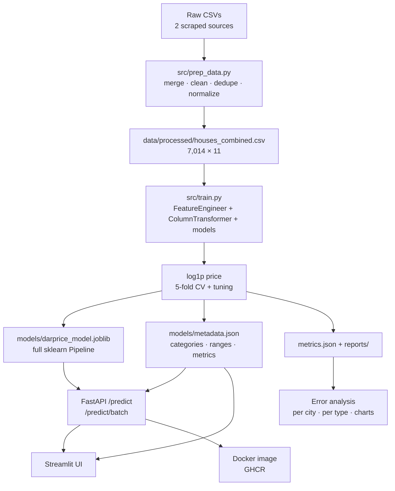
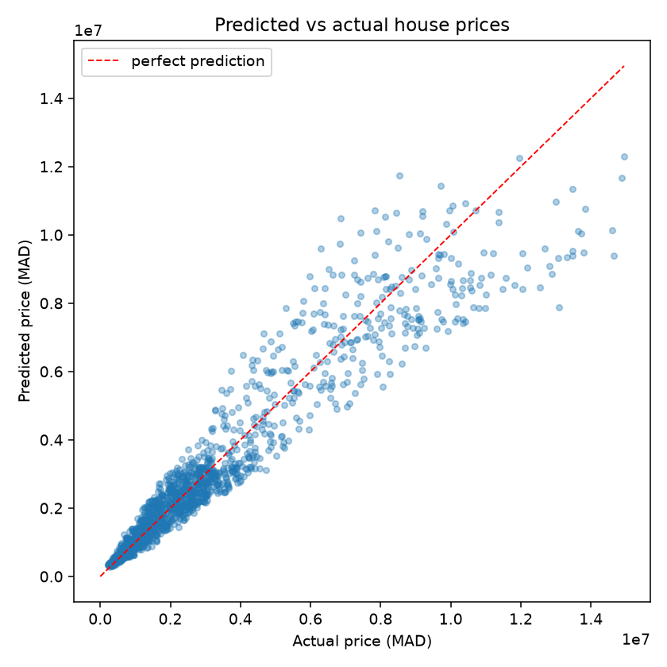
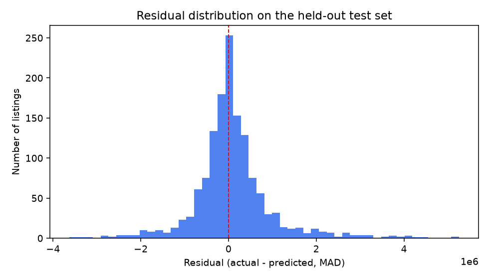
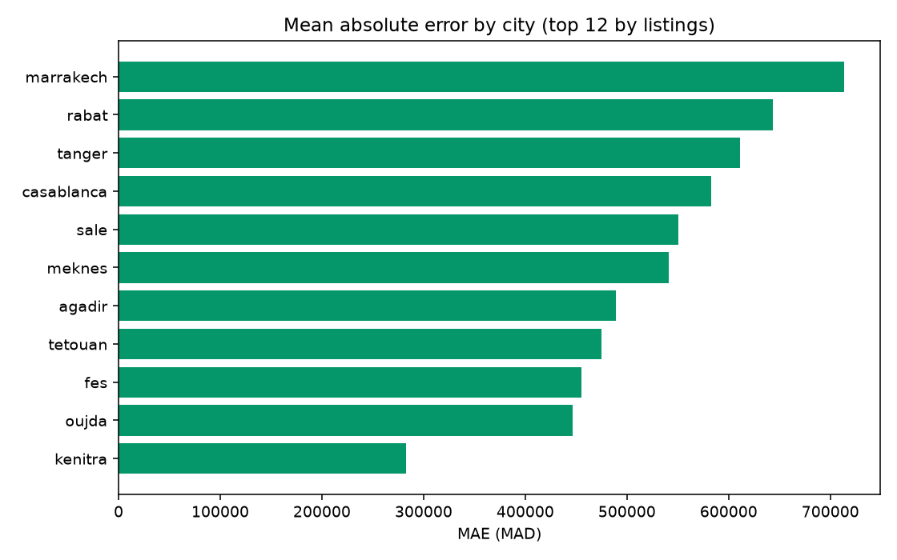
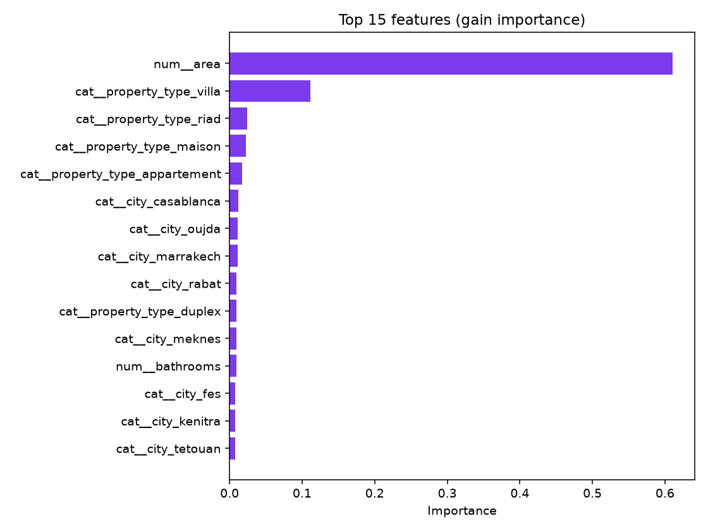

<div align="center">

# DarPrice — Moroccan House Price Predictor

**An end-to-end Machine Learning system that predicts Moroccan house prices (MAD)**
from listing features — from raw scraped CSVs to a tested, containerized REST API.

[](https://github.com/mohamedait-abbou/DarPrice-Moroccan-House-Price-Prediction/actions/workflows/ci.yml)
[](https://github.com/mohamedait-abbou/DarPrice-Moroccan-House-Price-Prediction/actions/workflows/cd.yml)


`Python` · `pandas` · `scikit-learn` · `XGBoost` · `FastAPI` · `Streamlit` · `Docker` · `GitHub Actions`

</div>

---

## Why this project exists

Most ML tutorials stop at a notebook with a nice score. DarPrice goes all the way:

1. **Prepare** — merge two messy sources, remove leakage/outliers, normalize text.
2. **Engineer** — add ratio features inside a reusable sklearn transformer.
3. **Train** — log-transform the target, compare 4 models with shuffled 5-fold CV,
   tune the trees, select by CV, evaluate **once** on a held-out test set.
4. **Explain** — per-city/per-type error analysis, worst predictions, charts.
5. **Serve** — load the full pipeline in FastAPI (no train/serve skew).
6. **Demo** — a friendly Streamlit UI.
7. **Ship** — 33 tests, lint/format, Docker, CI, and a GHCR image workflow.

> **New to the project?** Read [`docs/TUTORIAL.md`](docs/TUTORIAL.md) — a complete
> build-it-yourself guide that explains every file and every design decision.

---

## Architecture



---

## Demo

```bash
pip install -r requirements.txt
uvicorn app.main:app --reload
```

Interactive docs: **http://localhost:8000/docs**

```bash
curl -X POST http://localhost:8000/predict \
  -H "Content-Type: application/json" \
  -d '{
    "city": "casablanca",
    "neighborhood": "maarif",
    "property_type": "appartement",
    "condition": "bon etat",
    "area": 100,
    "rooms": 3,
    "bathrooms": 2,
    "floor": 2,
    "age": 10,
    "amenities_count": 3
  }'
```

```json
{
  "predicted_price_MAD": 1429120,
  "predicted_price_per_sqm_MAD": 14291,
  "currency": "MAD",
  "model": "XGBoost"
}
```

Health check:

```bash
curl http://localhost:8000/health
```

### Streamlit UI

```bash
pip install -r requirements-streamlit.txt
# terminal 1
uvicorn app.main:app --reload
# terminal 2
streamlit run app/streamlit_app.py
```

---

## API

| Method | Endpoint | Description |
|---|---|---|
| `GET` | `/` | Service info and endpoint list |
| `GET` | `/health` | Liveness + model/metadata status |
| `GET` | `/metadata` | Valid categories and numeric ranges |
| `GET` | `/model-info` | Metrics, best params, feature importance |
| `POST` | `/predict` | Predict one house |
| `POST` | `/predict/batch` | Predict up to 100 houses |

Inputs are validated with Pydantic and **normalized at serve time** (lowercase,
accents removed), so `"Casablanca"` and `"casablanca"` give the same prediction.
Every response includes `X-Process-Time-Ms`.

---

## Model performance

Trained on **7,014 cleaned listings**. The target is `log1p(price)` because raw
prices are heavily right-skewed (skew 1.66 → −0.14 after the log transform).

**Final model: `XGBoost`**, selected by 5-fold CV and evaluated **once** on a
held-out 20% test set:

| Metric | Value |
|---|---|
| MAE | **567,944 MAD** |
| RMSE | **902,824 MAD** |
| R² | **0.900** |
| Median absolute error | **334,542 MAD** |
| MAPE | **18.4%** |
| Predictions within 20% | **60.4%** |

5-fold CV comparison (log-space MAE, lower is better):

| Model | CV MAE |
|---|---|
| Linear Regression | 0.2020 |
| Random Forest | 0.1911 |
| Extra Trees | 0.1921 |
| **XGBoost (final)** | **0.1835** |

Top features (saved in `metrics.json`):

| Feature | Importance |
|---|---|
| `area` (m²) | 61.0% |
| `property_type=villa` | 11.1% |
| `property_type=riad` | 2.4% |
| `property_type=maison` | 2.2% |
| `city=marrakech` / `casablanca` | ~1.1% each |

> **Methodology note:** model selection uses only cross-validation on the
> training set. The test set is untouched until the final evaluation, so the
> reported score is honest.
>
> **Committed artifact:** the model checked into `models/` was produced with
> `python -m src.train --quick` (fixed 200-tree XGBoost) to keep the repository
> light and the build fast. Running `python -m src.train` performs the full
> RandomizedSearchCV tuning and may produce slightly different metrics. The
> training code, CV protocol, and reporting are identical in both modes.

### Error analysis

`python -m src.evaluate` regenerates the `reports/` folder:

| Chart | What it shows |
|---|---|
|  | Calibration across the price range |
|  | Whether errors are centered around zero |
|  | Where the model struggles geographically |
|  | What drives predictions |

Per-city, per-property-type, and worst-prediction tables are in
`reports/*.csv` and `reports/error_analysis.json`.

---

## Data

Two raw sources are merged:

| Source | Rows | Notes |
|---|---|---|
| `houses_data_eng.csv` | 4,675 | Scraped listings; only **24 unique feature combinations** after dedupe |
| `morocco_houses_dataset.csv` | 10,000 | Sales + rentals; only `transaction == "vente"` kept |

After cleaning: **7,014 rows × 11 columns**.

- **Leakage removed:** `price_per_sqm` (and identifiers/free text).
- **Outliers removed:** price ≤ 50k MAD, area < 10 m², price/m² outside 2k–80k.
- **Numeric sanity:** age 0–200, floor −10–200, rooms/bathrooms ≥ 0.
- **Text normalization:** `fès`/`fes`, `meknès`/`meknes` merged.
- **Duplicates removed:** prevents train/test leakage.

Full schema and rebuild instructions: [`data/README.md`](data/README.md).

---

## Quick start

Requires **Python 3.12+** (pinned dependencies were tested on Python 3.14).

```bash
git clone https://github.com/mohamedait-abbou/DarPrice-Moroccan-House-Price-Prediction.git
cd DarPrice-Moroccan-House-Price-Prediction

python -m venv venv && source venv/bin/activate
pip install -r requirements-dev.txt
pre-commit install

# Serve the committed model
uvicorn app.main:app --reload

# Optional: retrain from the committed cleaned dataset
python -m src.train

# Optional: rebuild the dataset from raw CSVs in data/raw/
python -m src.prep_data

# Optional: regenerate error reports without retraining
python -m src.evaluate

# Tests + lint + format check
make check
```

### Docker

```bash
docker compose up --build
# API on http://localhost:8000
```

Or use the published image:

```bash
docker pull ghcr.io/mohamedait-abbou/darprice:latest
docker run --rm -p 8000:8000 ghcr.io/mohamedait-abbou/darprice:latest
```

The image runs as a non-root user and has a `/health` healthcheck.

---

## Project structure

```text
DarPrice/
├── app/
│   ├── main.py                 # FastAPI: health, metadata, predict, batch
│   └── streamlit_app.py        # Streamlit demo UI
├── src/
│   ├── prep_data.py            # merge + clean + save processed CSV
│   ├── features.py             # FeatureEngineer transformer
│   ├── train.py                # CV, tuning, final eval, artifacts
│   └── evaluate.py             # standalone error analysis
├── tests/                      # 33 unit/API tests
├── data/
│   ├── raw/                    # original CSVs (gitignored)
│   ├── processed/houses_combined.csv
│   └── README.md
├── models/
│   ├── darprice_model.joblib   # full sklearn Pipeline
│   └── metadata.json           # categories, ranges, metrics
├── reports/                    # error analysis + charts
├── docs/
│   ├── TUTORIAL.md             # build-it-yourself guide
│   └── MODEL_CARD.md
├── .github/workflows/
│   ├── ci.yml                  # lint + format + tests + docker build
│   └── cd.yml                  # publish image to GHCR
├── Dockerfile
├── docker-compose.yml
├── Makefile
├── requirements.txt
├── requirements-train.txt
├── requirements-dev.txt
├── requirements-streamlit.txt
├── pyproject.toml
├── CONTRIBUTING.md
└── README.md
```

---

## How it works (short version)

```text
Raw CSVs
   │  src/prep_data.py — merge, normalize, remove leakage/outliers
   ▼
data/processed/houses_combined.csv (7,014 × 11)
   │  src/train.py
   ▼
log1p(price)
   ▼
sklearn Pipeline
   FeatureEngineer
      ├── area_per_room
      ├── rooms_plus_bath
      ├── amenities_per_100m2
      └── is_new
   ColumnTransformer
      ├── numeric  ──▶ median imputer → StandardScaler
      └── categorical ──▶ most-frequent imputer → OneHotEncoder
   ▼
XGBoost
   │
   ├── models/darprice_model.joblib
   ├── models/metadata.json
   ├── metrics.json
   └── reports/
   ▼
app/main.py (FastAPI) ──▶ POST /predict ──▶ expm1 → MAD
```

---

## Tech stack

| Area | Tools |
|---|---|
| Language | Python 3.12+ (tested on 3.14) |
| Data | pandas, numpy |
| ML | scikit-learn (`Pipeline`, `ColumnTransformer`, CV, tuning), XGBoost |
| Serving | FastAPI, uvicorn, pydantic v2 |
| UI | Streamlit |
| Serialization | joblib |
| Quality | pytest, pytest-cov, ruff, pre-commit, GitHub Actions |
| Packaging | Docker, docker compose, GHCR |

---

## Reproducibility

- Exact dependency versions are pinned in `requirements*.txt`.
- `metrics.json` records the seed, CV folds, best params, test metrics, feature
  importance, error analysis, and the Python/scikit-learn/XGBoost/pandas/numpy
  versions used.
- The cleaned dataset and trained model are committed, so results can be
  reproduced without re-downloading the raw sources.
- Fixed `random_state=42` for the split, CV folds, and model search.
- `DARP_PRICE_N_JOBS` controls parallelism for smaller machines.

---

## Documentation

- [`docs/TUTORIAL.md`](docs/TUTORIAL.md) — build the whole project yourself,
  with every file and concept explained.
- [`docs/MODEL_CARD.md`](docs/MODEL_CARD.md) — intended use, limitations,
  ethics, and evaluation details.
- [`data/README.md`](data/README.md) — data provenance, schema, and rebuild.
- [`CONTRIBUTING.md`](CONTRIBUTING.md) — setup, commands, and PR checklist.

---

## Roadmap

- [x] Log-transform the target (fixes price skew)
- [x] Add RMSE + shuffled 5-fold cross-validation
- [x] Add XGBoost, ExtraTrees, and hyperparameter tuning
- [x] Select by CV, evaluate once on a held-out test set
- [x] Save metrics, metadata, feature importance, and error reports
- [x] Feature engineering inside the pipeline
- [x] Unit + API tests and CI (ruff + pytest + coverage)
- [x] Docker containerization + GHCR publishing
- [x] Streamlit web UI
- [x] Input normalization at serve time
- [ ] Cloud deployment (Render / Railway / Hugging Face Spaces)
- [ ] Prediction intervals
- [ ] Live monitoring / drift detection
- [ ] Temporal validation with `listing_date`

---

## Author

**[Mohamed Ait Abbou](https://github.com/mohamedait-abbou)** — Data & Machine
Learning enthusiast building end-to-end ML systems on real-world data.

---

## License

MIT — see [LICENSE](LICENSE). The raw data is **not** covered by the MIT license;
check the original sources' terms before redistributing it.
